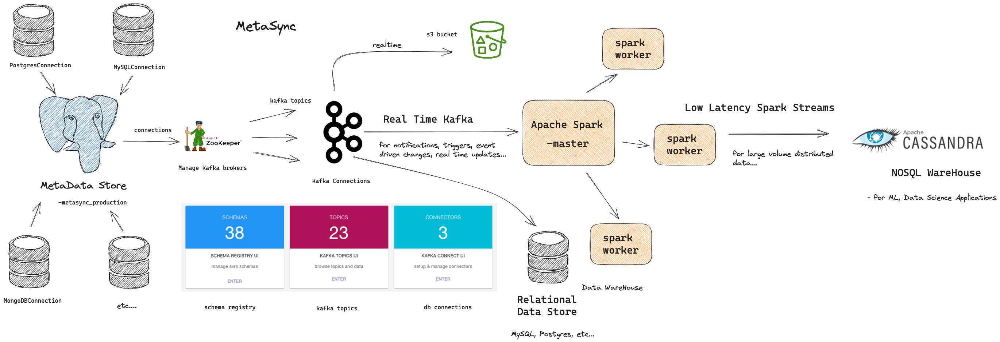

# MetaSync

MetaSync is a tool that allows real time data ingestion, supports a wide variety of Databases for extracting metadata.

<!-- 
https://github.com/VaibhavUpreti/MetaSync/assets/85568177/ed51645a-b98f-4c4e-bbd0-a12a4b62aeb9
-->

## Architecture

## ETL Data Pipeline

Metasync, real-time data synchronization tool provides best practices to ensure efficient and secure data synchronization.

- **Low Latency**: Metasync ensures minimal data synchronization latency, guaranteeing real-time updates.

- **Scalability**: Built to scale effortlessly as data volumes grow, accommodating increased demand.

- **Resilience**:  Metasync checks fault tolerance, ensuring uninterrupted data synchronization in the face of failures or disruptions.
